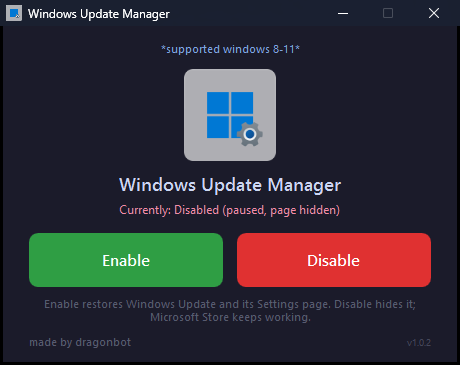

# Windows Update Manager

**Turn Windows Update off — and back on — without breaking the Microsoft Store.**

A tiny single-file Windows app for **Windows 8, 8.1, 10 and 11 (Home, Pro, Enterprise, Education)**.
No Group Policy Editor required, no services disabled, no third-party drivers.

[](LICENSE)
[](#requirements)
[](CHANGELOG.md)



---

## Why this exists

Most "disable Windows Update" tools stop `wuauserv`, set it to *Disabled*, and delete update
tasks. That works — but it also breaks the **Microsoft Store**, because the Store's install and
update pipeline relies on the same services.

This tool takes the opposite approach:

> **It never touches a single service.** It only applies policy and pause settings, then hides the
> Windows Update page in Settings so nothing can quietly turn itself back on.

Result: Windows Update stops, the Microsoft Store keeps working.

## Features

- **Two buttons.** Enable and Disable. Both finish in well under a second.
- **Policy-only.** `wuauserv`, `UsoSvc`, `DoSvc`, `bits`, `cryptsvc` and friends stay `Running`.
- **Fully reversible.** The complete original policy key, pause/release values, `Registry.pol`
  entries and Settings-page visibility are snapshotted before the first change and restored exactly.
  Pre-existing values such as `TargetReleaseVersion` are never destroyed.
- **Read-back verification.** After every action the app re-reads the machine and warns you if
  anything did not apply.
- **Hides the Windows Update page** in Settings while disabled, and brings it back when enabled.
- **Automatic backups.** Registry exports and `Registry.pol` are copied to
  `%ProgramData%\WindowsUpdateManager\backup-<timestamp>\` before every change.
- **Activity log.** Every action and verification result is written to
  `%ProgramData%\WindowsUpdateManager\manager.log` (rotated at 1 MB).
- **Managed-device aware.** Detects domain/Azure AD/MDM management and warns that organisation
  policy may override local settings.
- **Single instance.** A named mutex stops two copies from editing `Registry.pol` at once.
- **Works without `gpedit.msc`**, so Windows Home editions are supported.
- **Single `.exe`.** Logo, logic and icon are all embedded — no side files, no installer.
- **32-bit and 64-bit builds.** One file each, named so you can't grab the wrong one.

## Download

Grab the file that matches your Windows from the [Releases](../../releases) page:

| Your Windows | File |
| --- | --- |
| **64-bit** — Windows 8 / 8.1 / 10 / 11 x64 (almost everyone) | `Windows-Update-Manager-x64.exe` |
| **32-bit** — Windows 8 / 8.1 / 10 x86 | `Windows-Update-Manager-x86.exe` |

Not sure which one? Press <kbd>Win</kbd>+<kbd>Pause</kbd> (or Settings → System → About) and look at
**System type**. If it says *64-bit operating system*, use the x64 file.

> The 32-bit build is **only** for 32-bit Windows. On 64-bit Windows it shows a warning and exits
> instead of silently writing to the wrong registry view — use the x64 build there.
>
> The executables are **not code-signed**, so Windows SmartScreen may warn you the first time.
> Click *More info → Run anyway*, or [build it yourself](#build-from-source) — the whole build
> takes about a minute.

## Usage

1. Run `Windows-Update-Manager-x64.exe` (or the x86 file on 32-bit Windows) and approve the UAC
   prompt.
2. The status line shows the current state: `Currently: Enabled` or
   `Currently: Disabled (paused, page hidden)`.
3. Click **Disable** → confirm → Windows Update is paused, blocked by policy, and its Settings page
   is hidden.
4. Click **Enable** → everything is restored, including the Settings page.

Nothing is written next to the executable. Backups, the original-state snapshot and `manager.log`
live in `%ProgramData%\WindowsUpdateManager\`.

## What it actually changes

### Disable

| Area | Change |
| --- | --- |
| **Pause** | `HKLM\SOFTWARE\Microsoft\WindowsUpdate\UX\Settings` — pause start values set to now, all `Pause*EndTime` / `PauseUpdatesExpiryTime` set to `2099-12-31T23:59:59Z` |
| **Policy** | `HKLM\SOFTWARE\Policies\Microsoft\Windows\WindowsUpdate` — `SetDisableUXWUAccess`, `DoNotConnectToWindowsUpdateInternetLocations`, `DeferQualityUpdates(+PeriodInDays=30)`, `DeferFeatureUpdates(+PeriodInDays=30)` |
| **Policy (AU)** | `HKLM\SOFTWARE\Policies\Microsoft\Windows\WindowsUpdate\AU` — `NoAutoUpdate=1`, `AUOptions=1` |
| **Local GPO** | The same values are mirrored into `%SystemRoot%\System32\GroupPolicy\Machine\Registry.pol` so they survive a reboot / GP refresh |
| **Hide page** | `...\Policies\Explorer` → `SettingsPageVisibility` gets `windowsupdate` appended (existing tokens preserved) |
| **Legacy hide** | `...\Policies\WindowsUpdate` → `DisableWindowsUpdateAccess=1` (Windows 8/8.1/10) |
| **Bookkeeping** | `HKLM\SOFTWARE\WindowsUpdateManager` stores the original `SettingsPageVisibility` and `DisableWindowsUpdateAccess` values |
| **Snapshot** | Before the first change, the full policy key tree, pause/release values, `Registry.pol` entries and key-existence flags are saved to `%ProgramData%\WindowsUpdateManager\original-state\` |
| **Verification** | Every written value is read back; a mismatch is logged and shown in a warning dialog |
| **Services** | **Untouched** |

### Enable

Reverses every item above. When a snapshot exists it is restored byte-for-byte: the policy key is
recreated exactly, the original `Registry.pol` entries are put back, pause/release values are
restored, and the Settings page returns to its previous visibility. If no snapshot exists (for
example a machine disabled by an older version), Enable uses a safe fallback that removes only the
eight values and policy entries this tool owns, leaving pre-existing policy alone. Either way it
resets normal service start types and starts the update services.

### What it deliberately does *not* do

- ❌ Stop, disable, or re-configure services as part of Disable
- ❌ Edit the hosts file or firewall
- ❌ Delete scheduled tasks
- ❌ Install a driver, service, or background agent
- ❌ Phone home — the app makes no network requests at all

See [docs/how-it-works.md](docs/how-it-works.md) for the full technical write-up.

## Requirements

- Windows 8 / 8.1 / 10 / 11 — Home, Pro, Enterprise or Education
- Administrator rights (the app requests them automatically)
- 64-bit Windows for `Windows-Update-Manager-x64.exe`; 32-bit Windows for
  `Windows-Update-Manager-x86.exe`
- PowerShell 5.1 if you run the source instead of the `.exe`

## Build from source

```powershell
git clone https://github.com/Dragonbot-12012/windows-update-manager.git
cd windows-update-manager

Install-Module ps2exe -Scope CurrentUser -Force

# Produces dist\Windows-Update-Manager-x64.exe and dist\Windows-Update-Manager-x86.exe
.\src\Build-Exe.ps1
```

Useful switches:

```powershell
.\src\Build-Exe.ps1 -Architecture x64          # only the 64-bit build
.\src\Build-Exe.ps1 -Architecture x86          # only the 32-bit build
.\src\Build-Exe.ps1 -Version 1.0.2.0
.\src\Build-Exe.ps1 -Architecture x64 -OutputPath "$env:TEMP\WUM.exe"
```

The build verifies the PE header of every output (`0x8664` for x64, `0x014C` for x86), so a
mis-labelled binary fails the build instead of shipping.

**Run without compiling:**

```powershell
# GUI (double-click also works)
.\src\Windows Update Manager.vbs

# or directly
powershell -NoProfile -ExecutionPolicy Bypass -STA -File .\src\WindowsUpdateManager.ps1
```

On 64-bit Windows, run the source from **64-bit PowerShell**. A 32-bit session is redirected to
`WOW6432Node` / `SysWOW64`, so the scripts refuse to run there rather than write to the wrong place.

**Standalone scripts** (console, no GUI):

```powershell
.\src\Disable-WindowsUpdate.ps1
.\src\Enable-WindowsUpdate.ps1
```

## Tests

`Test-WuManager.ps1` runs four full `Disable → Enable` cycles and verifies every state transition
(policy key present/absent, pause window, `Registry.pol` entries, page visibility, service state).
It also seeds a realistic pre-existing policy and checks that Disable → Enable restores it exactly,
then deletes the snapshot and checks the safe fallback leaves pre-existing values alone.

```powershell
.\src\Test-WuManager.ps1
```

The log is written to `%TEMP%\wu-manager-test.log`. The v1.0.2 release passes **143 / 143** checks.

## Project layout

```
windows-update-manager/
├─ src/
│  ├─ WuCore.ps1                  # all enable/disable logic (shared by GUI + tests)
│  ├─ WindowsUpdateManager.ps1    # WPF GUI
│  ├─ Build-Exe.ps1               # x64 + x86 single-file .exe build
│  ├─ Disable-WindowsUpdate.ps1   # standalone console version
│  ├─ Enable-WindowsUpdate.ps1    # standalone console version
│  ├─ Test-WuManager.ps1          # self-test harness
│  └─ Windows Update Manager.vbs  # windowless launcher
├─ assets/                        # logo source, PNG and generated ICO
├─ docs/                          # how-it-works, troubleshooting, screenshot
└─ .github/workflows/build.yml    # CI: build both architectures + attach to tagged releases
```

## Uninstall

1. Click **Enable** so Windows Update is restored.
2. Close the app and delete the `.exe`.
3. Remove the leftover state and backups:

   ```powershell
   Remove-Item 'HKLM:\SOFTWARE\WindowsUpdateManager' -Recurse -Force -ErrorAction SilentlyContinue
   Remove-Item "$env:ProgramData\WindowsUpdateManager" -Recurse -Force -ErrorAction SilentlyContinue
   ```

If something still looks wrong, the `backup-<timestamp>` folders contain `.reg` files and the
original `Registry.pol` you can re-import.

## Troubleshooting

See [docs/troubleshooting.md](docs/troubleshooting.md).

## Security

This is an administrator tool that edits `HKLM` and `Registry.pol`. Please read
[SECURITY.md](SECURITY.md) before running a build you did not compile yourself.

## Trademark notice

The Windows logo in `assets/` is a trademark of Microsoft Corporation. It is included only to
identify the operating system this tool targets and is **not** covered by the MIT license. This
project is not affiliated with, endorsed by, or sponsored by Microsoft.

## License

[MIT](LICENSE) © dragonbot
